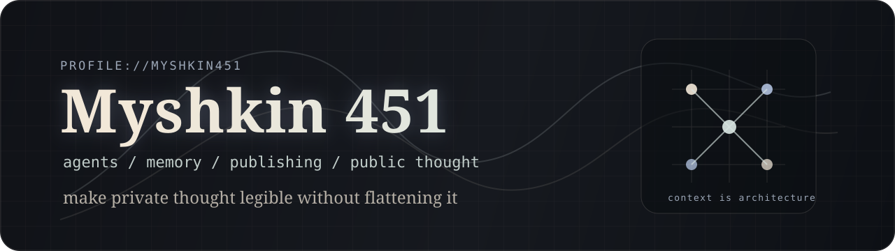

<p align="center">
  
</p>

<p align="center">
  <a href="https://www.myshkin451.com"><strong>www.myshkin451.com</strong></a>
  <span> / </span>
  <a href="https://github.com/myshkin451?tab=repositories">repositories</a>
  <span> / </span>
  <a href="https://github.com/myshkin451/myshkin-github-radar">github radar</a>
  <span> / </span>
  <a href="https://github.com/myshkin451/github-achievement-lab">achievement lab</a>
</p>

<p align="center">
  
  
  
  
  
</p>

<p align="center">
  <a href="https://github.com/myshkin451/myshkin-github-radar/actions/workflows/ci.yml">
    
  </a>
  <a href="https://github.com/myshkin451/github-achievement-lab/actions/workflows/ci.yml">
    
  </a>
</p>

<p align="center">
  
</p>

## A Small Public Room

Somewhere between Prince Myshkin and 451 degrees, I keep a small room for
attention: notes, tools, questions, and a few badges pinned to the door.

I work around agents, knowledge systems, and personal publishing. I am interested
in software as a way of thinking in public: not just shipping artifacts, but
leaving better traces for the next person who has to understand the room.

The public repos are part workshop, part notebook, part trophy wall. The real
direction is still being made by building, reading other people's code, and
contributing where I can.

## Current Coordinates

| Axis | What I keep circling |
| --- | --- |
| Agents | Collaborators with memory, limits, and context; not mascots, not magic. |
| Knowledge systems | Retrieval, notes, schemas, and the craft of making useful context reappear. |
| Personal publishing | A website as a thinking room, not only a billboard. |
| GitHub surface | Profile README, API tooling, badges, achievements, and open-source traces. |
| Open source | Small, concrete PRs; quiet fixes; writing that lowers the cost of understanding. |

## Badge Board

| Track | Status | Public trace |
| --- | --- | --- |
| Profile README | Live | This page |
| GitHub API integration | Built | [`myshkin-github-radar`](https://github.com/myshkin451/myshkin-github-radar) |
| Developer Program Member | Preparing | [`DEVELOPER_PROGRAM.md`](https://github.com/myshkin451/myshkin-github-radar/blob/main/DEVELOPER_PROGRAM.md) |
| YOLO achievement | Attempted | [`github-achievement-lab#1`](https://github.com/myshkin451/github-achievement-lab/pull/1) |
| Galaxy Brain achievement | Attempted | [`Discussions`](https://github.com/myshkin451/github-achievement-lab/discussions) |
| Daily private contribution log | Running | Private Codex activity log |
| Certifications | Planned | GitHub Foundations, Actions, Copilot |

## Working Questions

> A tool is a thought with handles.

> Memory is useful only when it changes what you notice next.

> Public writing is not self-display; it is a way to make thinking accountable.

> A good contribution leaves the room easier to work in.

## Open-Source Posture

I am trying to become useful in public without performing usefulness too loudly.

That usually means:

- reading before changing;
- keeping PRs narrow enough to review;
- explaining tradeoffs instead of selling certainty;
- improving documentation when code is not the only problem;
- treating maintainers' attention as a finite resource.

## Signal Panels

<p align="center">
  
  
</p>

## Field Notes

```text
now
  building small agent and GitHub API tools
  shaping a long-lived personal website
  collecting badges, but leaving evidence behind them
  learning from mature projects through small open-source PRs

next
  GitHub Developer Program application
  public sponsor badge path
  GitHub Foundations and Actions certifications
  fewer demos, more durable systems
```

---

<p align="center">
  <sub>quiet work, clear traces, useful context, visible badges</sub>
</p>
